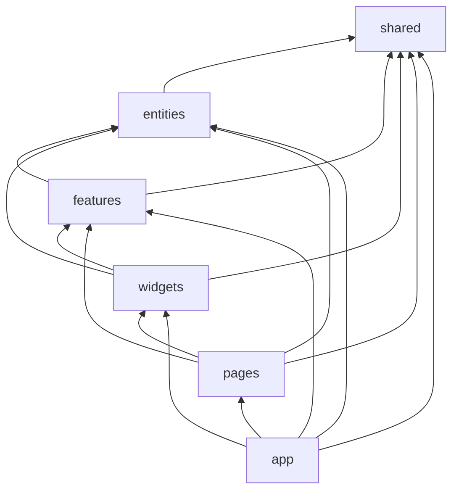

# Лабораторна робота №6 — FSD, Pinia та PrimeVue

Vue 3 SPA з Feature-Sliced Design, Vue Router, Pinia, PrimeVue, TypeScript, VeeValidate/Yup і DummyJSON API.

## Запуск

```sh
npm install
npm run dev
```

Перед запуском скопіюйте `.env.example` у `.env` і задайте `VITE_API_URL`.

Тестовий обліковий запис DummyJSON: `emilys` / `emilyspass`.

## Перевірки

```sh
npm run type-check
npm run lint
npm run lint:fsd
npm run build
```

## Реалізовано

- Збережено маршрутизацію, авторизацію, захищені маршрути, пошук, пагінацію і CRUD із лабораторної №5.
- Код організовано за шарами `app`, `pages`, `widgets`, `features`, `entities`, `shared`; зовнішні шари відкриваються через `index.ts`.
- `eslint-plugin-boundaries` перевіряє дозволені залежності між шарами командою `npm run lint:fsd`.
- Pinia setup-stores керують сесією, користувачами й налаштуваннями; сервіси реєструються в `app/providers/services.ts`.
- PrimeVue компоненти використовуються через обгортки з `shared/ui`, зокрема таблицю, поля вводу, кнопки та діалог підтвердження.
- Перемикач світлої/темної теми зберігає налаштування через `pinia-plugin-persistedstate`. Сесія токенів зберігається вручну в localStorage; це демонструє різницю між персистентністю всього store та вибраним форматом сесії.
- DummyJSON імітує створення, оновлення й видалення: локальний стан відображає результати цих операцій до перезавантаження.

## Залежності шарів



Для перевірки актуальної структури виконайте `npm run lint:fsd`.
